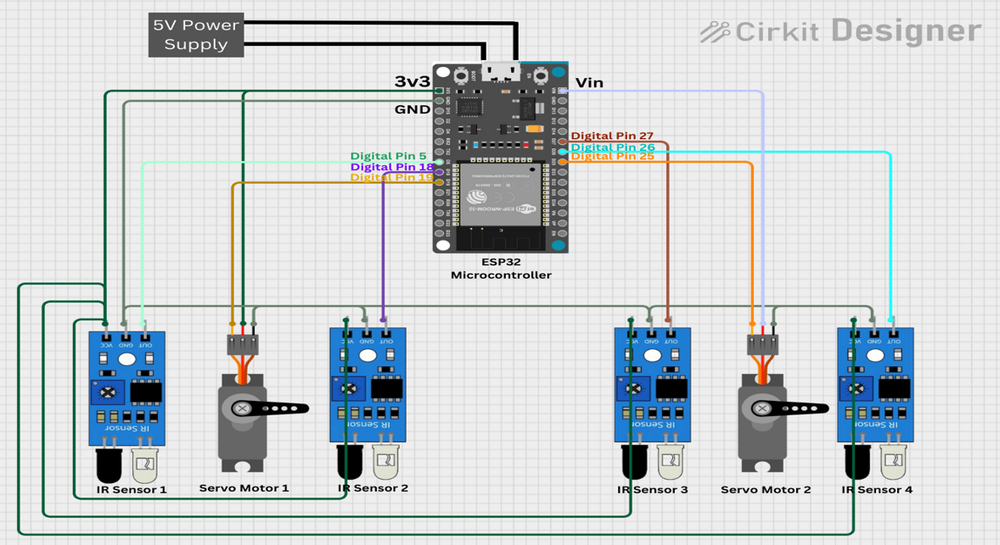
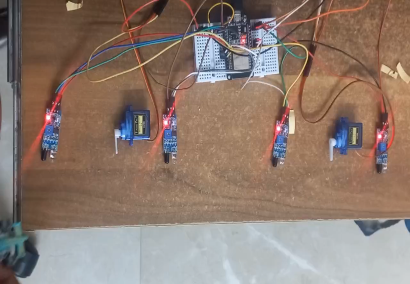

# 🔧 Components List

This document lists all the hardware and software components required to build the **Automated Parking System**.

---

## Hardware Components

| Sr. No. | Component | Quantity | Description |
|:---:|---|:---:|---|
| 1 | ESP32 Development Board | 1 | Main microcontroller used to control the entire system |
| 2 | IR Sensor Module | 4 | Detects vehicle entry and exit |
| 3 | Servo Motor (SG90/MG90S) | 2 | Controls the entry and exit barriers |
| 4 | 5V Power Supply | 1 | Powers the ESP32, sensors, and servo motors |
| 5 | Breadboard | 1 | Used for prototype circuit connections |
| 6 | Jumper Wires | As Required | Used for electrical connections between components |
| 7 | USB Cable | 1 | Used to program and power the ESP32 |

---

## ESP32 Pin Configuration

| Component | GPIO Pin |
|---|:---:|
| IR Sensor 1 (Entry Detection) | GPIO 5 |
| IR Sensor 2 (Entry Confirmation) | GPIO 18 |
| IR Sensor 3 (Exit Detection) | GPIO 27 |
| IR Sensor 4 (Exit Confirmation) | GPIO 26 |
| Servo Motor 1 (Entry Gate) | GPIO 19 |
| Servo Motor 2 (Exit Gate) | GPIO 25 |

---

## Software Requirements

| Software | Purpose |
|---|---|
| Arduino IDE | Writing and uploading code to the ESP32 |
| ESP32 Board Package | Enables ESP32 support in the Arduino IDE |
| `ESP32Servo` Library | Controls the servo motors |

---

## System Specifications

| Parameter | Value |
|---|---|
| Microcontroller | ESP32 |
| Parking Capacity | 10 Slots (configurable via `maxSlots` in firmware) |
| Entry Sensors | 2 (Detection + Confirmation) |
| Exit Sensors | 2 (Detection + Confirmation) |
| Gate Actuators | 2 Servo Motors |
| Serial Baud Rate | 115200 |

---

## Wiring Overview

  

  

- All IR sensors share a common **VCC/GND** rail powered from the 5V supply, with each sensor's `OUT` pin routed to its dedicated ESP32 GPIO.
- Both servo motors similarly share power/ground while each receiving its own PWM control line from the ESP32.

For the full pin-by-pin breakdown and system-level data flow, see [`System_Architecture.md`](System_Architecture.md).
