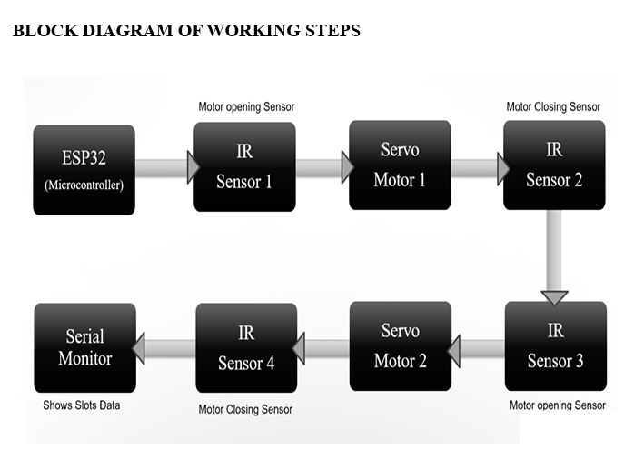
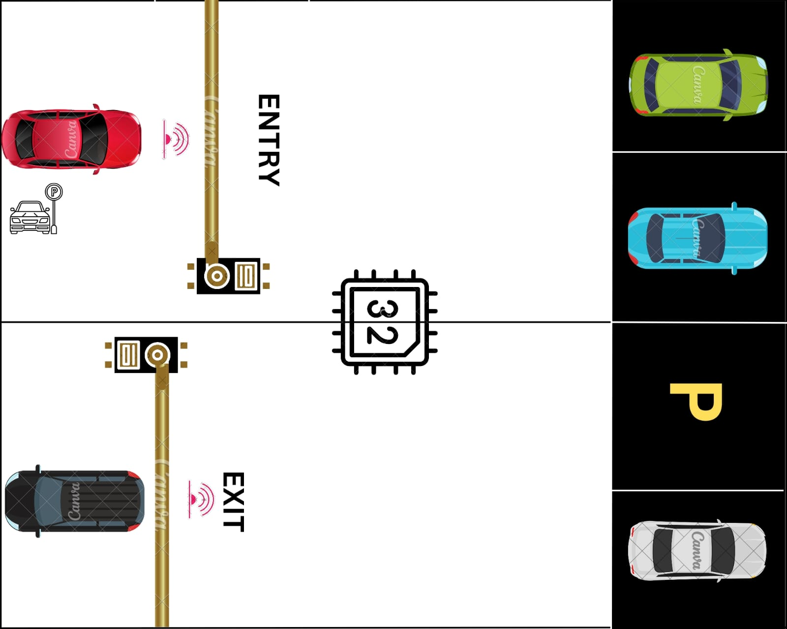

<h1 align="center">Automated Parking System (ESP32-Based)</h1>

<p align="center">
  <em>An IoT-based automated parking system using an ESP32 microcontroller, IR sensors, and servo-controlled entry/exit gates.</em>
</p>

<p align="center">
  
  
  
  
  
</p>

---

## 📖 About the Project

The **Automated Parking System** is an embedded systems project that automates vehicle entry and exit in a parking facility using an **ESP32 microcontroller**, **four IR sensors**, and **two servo-controlled barrier gates**. It tracks the number of occupied/available parking slots in real time, automatically opens or closes the entry and exit gates based on sensor input, and prevents new vehicles from entering once the lot is full — all without any human intervention.

This project was built as a final-year Electronics & Telecommunication Engineering project at **AISSMS Institute of Information Technology (IOIT)**, demonstrating practical skills in embedded C++ programming, sensor-actuator interfacing, and real-time system design.

---

## ✨ Features

- 🚦 Automatic vehicle entry and exit detection using dual IR sensor pairs
- 🔢 Real-time parking slot counting (supports 10 slots by default, easily scalable)
- 🎚️ Automatic gate control via two independent servo motors (entry & exit)
- 🚫 Automatically prevents entry when the parking lot is full
- 🖥️ Live slot availability displayed on the Arduino Serial Monitor
- 💸 Low-cost, beginner-friendly hardware (ESP32 + IR sensors + SG90 servos)
- 📈 Simple, scalable architecture — extendable to more slots or added features

---

## 🛠️ Technologies & Hardware Used

| Category | Details |
|---|---|
| Microcontroller | ESP32 Development Board |
| Language / Framework | C++ (Arduino framework), `ESP32Servo` library |
| IDE | Arduino IDE |
| Sensors | 4 × IR Sensor Modules |
| Actuators | 2 × Servo Motors (SG90 / MG90S) |
| Power | 5V Power Supply |
| Prototyping | Breadboard, Jumper Wires |

---

## 📁 Project Structure

```
Automated-Parking-System/
│
├── readme.md
├── LICENSE
├── .gitignore
│
├── Arduino code/
│   └── AutomatedParkingSystem/
│       └── AutomatedParkingSystem.ino
│
├── Hardware/
│   ├── Block_Diagram.png
│   ├── Circuit_Design.png
│   ├── Working_Setup_Photo.png
│   ├── Concept_Design.jpeg
│   └── Output_Serial_Monitor.png
│
└── Documentation/
    ├── Project_Report.md
    ├── Working_Principle.md
    ├── System_Architecture.md
    ├── Components_List.md
    ├── Installation_Guide.md
    ├── Future_Improvements.md
    └── Troubleshooting.md
```

> 💡 The sketch lives in `Arduino code/AutomatedParkingSystem/AutomatedParkingSystem.ino` — Arduino IDE requires the `.ino` file to sit inside a folder of the exact same name, so keep that structure intact when opening the project.
>
> ℹ️ This project has no software dashboard (it's a standalone embedded firmware project that reports to the Serial Monitor), so there's no `Dashboard/` folder here. If you build a Wi-Fi/web dashboard as a future enhancement (see [`Documentation/Future_Improvements.md`](Documentation/Future_Improvements.md)), that's the natural place to add it.

---

## 🔌 Pin Configuration

| Component | ESP32 GPIO |
|---|:---:|
| IR Sensor 1 (Entry Detection) | GPIO 5 |
| IR Sensor 2 (Entry Confirmation) | GPIO 18 |
| IR Sensor 3 (Exit Detection) | GPIO 27 |
| IR Sensor 4 (Exit Confirmation) | GPIO 26 |
| Servo Motor 1 (Entry Gate) | GPIO 19 |
| Servo Motor 2 (Exit Gate) | GPIO 25 |

📌 Full component specs and wiring: [`Documentation/Components_List.md`](Documentation/Components_List.md)

---

## 🖼️ Block Diagram

<p align="center">
  
</p>

Signal flow: **ESP32 → IR Sensor 1 → Servo Motor 1 → IR Sensor 2 → IR Sensor 3 → Servo Motor 2 → IR Sensor 4 → Serial Monitor** — each stage detecting, actuating, or confirming a step of the entry/exit sequence.

---

## 🔧 Circuit Design

<p align="center">
  
</p>

All four IR sensors and both servo motors connect back to the ESP32's GPIO pins and a shared 5V supply / GND rail, as detailed in the [Pin Configuration](#-pin-configuration) table above.

---

## ⚙️ Installation

### 1. Clone the repository
```bash
git clone https://github.com/YOUR_USERNAME/Automated-Parking-System.git
cd Automated-Parking-System
```

### 2. Open the firmware in Arduino IDE
Open `Arduino code/AutomatedParkingSystem/AutomatedParkingSystem.ino` in the Arduino IDE.

### 3. Install the ESP32 board package and required library
- Add ESP32 board support via Boards Manager.
- Install the **ESP32Servo** library via Library Manager.

### 4. Wire the hardware
Follow the [Circuit Design](#-circuit-design) diagram and the [Pin Configuration](#-pin-configuration) table.

### 5. Upload and monitor
Select your ESP32 board/port, upload the sketch, then open the Serial Monitor at **115200 baud**.

> 🧭 Full step-by-step walkthrough (including common setup errors): [`Documentation/Installation_Guide.md`](Documentation/Installation_Guide.md)

---

## ⚙️ Working Principle

### Vehicle Entry
1. **IR Sensor 1** detects an approaching vehicle at the entry point.
2. The ESP32 checks whether any parking slots are still available.
3. If slots are available, **Servo Motor 1** opens the entry gate and the occupied-slot count increases.
4. **IR Sensor 2** detects that the vehicle has fully crossed the gate.
5. The entry gate closes automatically.

### Vehicle Exit
1. **IR Sensor 3** detects a vehicle approaching the exit.
2. **Servo Motor 2** opens the exit gate and the occupied-slot count decreases.
3. **IR Sensor 4** confirms the vehicle has exited.
4. The exit gate closes automatically.

Throughout, the ESP32 continuously prints the number of available slots to the Serial Monitor, and keeps the entry gate closed whenever the lot is full.

📌 Full explanation: [`Documentation/Working_Principle.md`](Documentation/Working_Principle.md)

---

## 📊 System Workflow

```
Vehicle Arrives
       │
       ▼
IR Sensor 1 Detects Vehicle
       │
       ▼
Check Available Slots
       │
 ┌─────┴─────┐
 │           │
Yes         No
 │           │
 ▼           ▼
Open Gate   Gate Remains Closed
 │
 ▼
Vehicle Passes Sensor 2
 │
 ▼
Close Entry Gate → Update Slot Count
 │
 ▼
 (Later) Vehicle Exits
 │
 ▼
IR Sensor 3 Detects Vehicle → Open Exit Gate
 │
 ▼
Vehicle Passes Sensor 4 → Close Exit Gate
 │
 ▼
Increase Available Slots
```

---

## 📸 Screenshots

| Concept Design | Real Hardware Setup | Serial Monitor Output |
|---|---|---|
|  |  |  |

---

## 📈 Advantages

- Reduces manual work and staffing needs at parking checkpoints
- Saves time for drivers by automating gate control
- Cost-effective — built entirely from low-cost, widely available components
- Simple to implement and easy to understand/extend
- Scalable to larger parking areas by adding more sensor/servo pairs
- A solid foundation for smart-parking and smart-city applications

## ⚠️ Limitations

- Slot count is tracked in memory only — resets on power loss/reboot, with no persistent storage
- No individual slot-level tracking — only a single aggregate count of occupied/available slots
- No authentication or vehicle identification (any vehicle can enter if slots are free)
- Fixed 2-second sensor debounce delays may need tuning for faster-moving traffic
- No wireless/remote monitoring in the current version (despite the ESP32's Wi-Fi capability)

---

## 🚀 Future Enhancements

- 📱 Mobile app integration for remote slot availability checks
- 🌐 Wi-Fi dashboard leveraging the ESP32's built-in connectivity
- 🪪 RFID-based vehicle/user authentication
- 🔲 QR code-based entry system
- 🗓️ Online slot reservation
- 💳 Automatic billing system
- ☁️ Cloud database integration for historical logging
- 🤖 AI-based parking demand prediction
- 🔍 ANPR (Automatic Number Plate Recognition) for entry/exit logging

📌 Full roadmap: [`Documentation/Future_Improvements.md`](Documentation/Future_Improvements.md)

---

## 🎓 Learning Outcomes

- Interfacing multiple digital sensors (IR modules) with an ESP32 microcontroller
- Controlling servo motors via PWM using the `ESP32Servo` library
- Designing debounced, state-tracked sensor logic (`sensorTriggered` flags) to avoid duplicate detections
- Structuring embedded C++ code around a `setup()`/`loop()` real-time control cycle
- Reading and interpreting circuit schematics and translating them into working wiring
- Documenting a hardware project for both technical and non-technical audiences

---

## 🏁 Conclusion

The Automated Parking System demonstrates the effective integration of low-cost embedded hardware and simple, robust firmware logic to automate a real-world process — vehicle entry/exit and slot tracking — that is traditionally handled manually. By combining IR sensors, servo motors, and an ESP32 microcontroller, the system eliminates human error, speeds up the parking process, and offers a scalable, extensible foundation for smart-parking and smart-city applications such as malls, offices, and residential complexes.

📌 Full engineering report: [`Documentation/Project_Report.md`](Documentation/Project_Report.md)

---

## 👨‍💻 Authors

**Atharva Pednekar** (PRN: 23310004)
**Shivam Borane** (PRN: 23310015)

Department of Electronics & Telecommunication
AISSMS Institute of Information Technology (IOIT)

---

## 📄 License

This project is licensed under the **MIT License** — see the [LICENSE](LICENSE) file for details.

---

<p align="center">Built with ESP32 &amp; Arduino</p>
